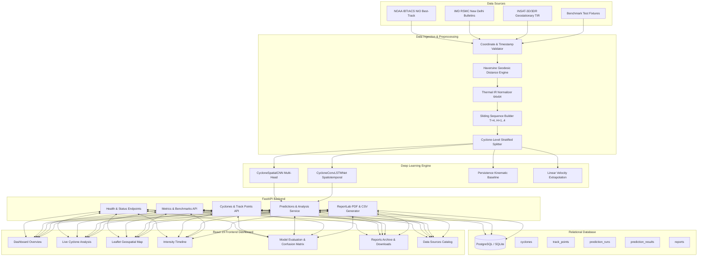
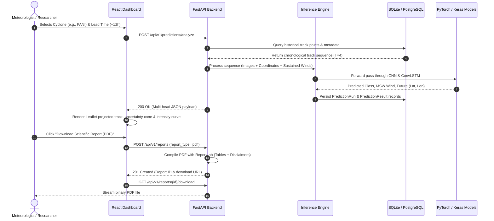
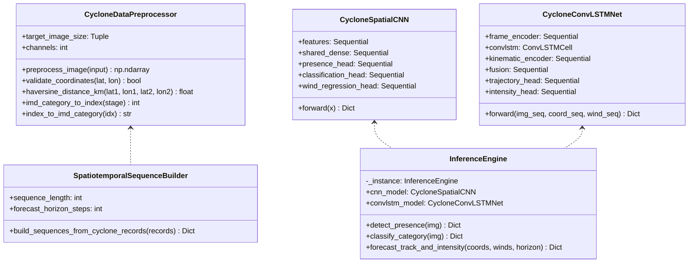
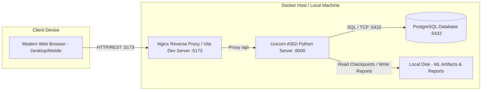

# System Architecture & Technical Design

## 1. Executive Architecture Summary
The system is an end-to-end meteorological deep learning platform engineered for tropical cyclone convective presence detection, 7-stage intensity categorization (India Meteorological Department standard), and multi-horizon (+6h, +12h, +18h, +24h) trajectory and central intensity forecasting in the North Indian Ocean (Bay of Bengal and Arabian Sea).

The system integrates:
- **FastAPI Python Backend** with SQLAlchemy 2.0 ORM, Alembic migrations, Pydantic v2 schemas, ReportLab PDF generation, and streaming CSV exports.
- **Deep Learning Pipelines**:
  - Spatial Multi-Head CNN (extracts hierarchical cloud morphology from satellite thermal infrared imagery).
  - Spatiotemporal ConvLSTM (fuses convective rotational memory from sequential frames $T=4$ with kinematic track observations).
- **Relational Storage**: PostgreSQL production target with zero-configuration SQLite local development and test fallback.
- **Interactive React 19 + TypeScript + Vite Dashboard** with Leaflet mapping, SVG intensity profiles, benchmark comparison charts, and one-click report downloads.

---

## 2. System Architecture Diagram

---

## 3. Data Flow Diagram

---

## 4. Component Diagram

---

## 5. Deployment Diagram

