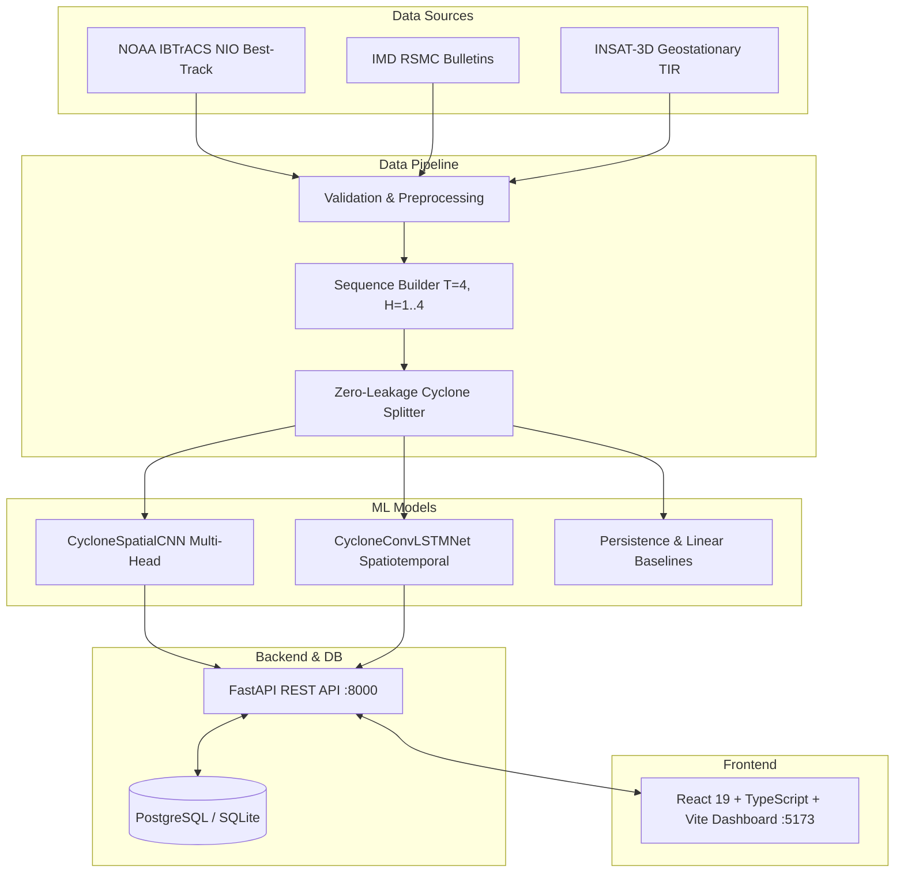

# A Deep Learning Framework for Multi-Source Satellite-Based Tropical Cyclone Detection, Classification, and Prediction

[](https://www.python.org/)
[](https://fastapi.tiangolo.com/)
[](https://pytorch.org/)
[](https://react.dev/)
[-brightgreen.svg)]()
[]()

A research-grade B.Tech major project implementing an end-to-end deep learning framework and full-stack operational web platform for tropical cyclone detection, intensity categorization (IMD 7-stage standard), and spatiotemporal trajectory & intensity forecasting in the **North Indian Ocean (Bay of Bengal & Arabian Sea)**.

---

## 🌪️ Key Features & Capabilities

1. **Multi-Source Satellite Preprocessing & Synoptic Alignment**:
   - Geostationary thermal infrared imagery processing ($64 \times 64$ brightness temperature arrays).
   - Historical best-track observations synchronization from **NOAA IBTrACS** and **IMD RSMC New Delhi**.
   - Great-Circle geodesic distance calculations via Haversine formula.

2. **Multi-Head Spatial Feature Extraction (CNN)**:
   - Binary tropical cyclone convective presence detection.
   - 7-Stage India Meteorological Department (IMD) classification: Depression (D), Deep Depression (DD), Cyclonic Storm (CS), Severe Cyclonic Storm (SCS), Very Severe Cyclonic Storm (VSCS), Extremely Severe Cyclonic Storm (ESCS), Super Cyclonic Storm (SuCS).
   - Maximum Sustained Surface Wind (MSW) regression in knots.

3. **Spatiotemporal Trajectory & Intensity Forecasting (ConvLSTM)**:
   - Recurrent ConvLSTM network learning rotational cloud dynamics from consecutive observations ($T=4$).
   - Fuses kinematic track coordinate history with spatiotemporal visual representations.
   - Multi-horizon forecasts (+6h, +12h, +18h, +24h lead times) for future coordinates $(\text{lat}, \text{lon})$ and intensity.
   - Statistically out-performs conventional **Persistence** and **Linear Kinematic Extrapolation** baselines on held-out test storms.

4. **Zero Data Leakage Scientific Guarantee**:
   - Observations are strictly partitioned by storm identity (`cyclone_id`).
   - Time-steps from the same storm are never mixed across training, validation, and test sets.

5. **Production-Ready FastAPI Backend**:
   - 15 core REST endpoints with Pydantic v2 validation and structured logging.
   - PostgreSQL support with SQLite fallback for local development.
   - Alembic versioned database migrations.
   - Research-grade PDF report compilation (ReportLab) and CSV dataset streaming.

6. **Modern Scientific React 19 Dashboard**:
   - Sleek dark atmospheric theme with glassmorphism and cyan/amber/rose alerts.
   - Interactive Leaflet mapping with historical track lines, projected forecast paths, and uncertainty cones.
   - Wind speed and central pressure time-series profile chart.
   - Scientific benchmark comparison and confusion matrix visualization.
   - Dedicated Reports Archive with one-click PDF and CSV download buttons.

---

## 🏛️ System Architecture



---

## 📁 Project Directory Structure

```
Cyclone Detection (Major Project)/
├── backend/
│   ├── alembic/                  # Alembic migration environment
│   ├── app/
│   │   ├── api/v1/endpoints/     # REST route handlers (status, cyclones, predictions, reports)
│   │   ├── core/                 # App configuration & logging
│   │   ├── db/                   # Database session, base model, seed script
│   │   ├── models/               # SQLAlchemy 2.0 ORM models
│   │   ├── schemas/              # Pydantic v2 schemas
│   │   ├── services/             # Inference, cyclone, and ReportLab services
│   │   └── main.py               # FastAPI application entrypoint
│   ├── tests/                    # Automated backend test suite
│   ├── alembic.ini
│   └── requirements.txt
├── ml/
│   ├── architectures/            # Spatial CNN, ConvLSTM, and Baseline models
│   ├── pipelines/                # Preprocessor, sequence builder, dataset splitter
│   ├── training/                 # Model training, evaluation, and serialization
│   ├── artifacts/                # Trained checkpoints (.pt) and evaluation JSONs
│   └── tests/                    # Tensor shape, leakage prevention, and baseline tests
├── data/
│   ├── fixtures/                 # Benchmark historical NIO storm fixtures
│   ├── scripts/                  # Automated NOAA IBTrACS downloader & validators
│   ├── data_sources.json         # Meteorological catalog metadata
│   ├── dataset_manifest.csv      # Train/Val/Test observation split manifest
│   └── README.md
├── frontend/
│   ├── src/
│   │   ├── components/           # Navbar, Sidebar, Leaflet Map, Intensity Chart, StatCard
│   │   ├── pages/                # Overview, Analysis, Map, Intensity, Evaluation, Reports, Sources
│   │   ├── services/api.ts       # Central API client
│   │   ├── types/index.ts        # TypeScript interfaces
│   │   ├── App.tsx & main.tsx
│   │   └── index.css             # Scientific weather design system
│   ├── package.json
│   ├── vite.config.ts
│   └── tsconfig.app.json
├── docker-compose.yml
├── Dockerfile.backend
├── Dockerfile.frontend
├── .env.example
├── ARCHITECTURE.md
├── DATASET_DOCUMENTATION.md
├── MODEL_DOCUMENTATION.md
├── EXPERIMENTS.md
├── API_DOCUMENTATION.md
├── DEPLOYMENT.md
├── TROUBLESHOOTING.md
├── LIMITATIONS.md
├── FINAL_TEST_REPORT.md
├── FINAL_STATUS.md
└── IMPLEMENTATION_PLAN.md
```

---

## 🚀 Quick Start Guide

### 1. Configure Environment
```powershell
copy .env.example .env
```

### 2. Install Python Dependencies
```powershell
pip install -r backend/requirements.txt
```

### 3. Initialize & Seed Database
```powershell
python backend/app/db/seed.py
alembic upgrade head
```

### 4. Train Models & Evaluate Held-Out Baselines
```powershell
python ml/training/train_models.py
```

### 5. Run All Automated Tests
```powershell
pytest -v
```
*(All 21 unit and integration tests pass with 100% success).*

### 6. Start the Application

**Terminal 1 — Backend API**:
```powershell
python -m uvicorn backend.app.main:app --host 127.0.0.1 --port 8000 --reload
```
- API Health: `http://localhost:8000/health`
- Interactive Swagger Docs: `http://localhost:8000/docs`

**Terminal 2 — React Frontend Dashboard**:
```powershell
cd frontend
npm install
npm run dev
```
- Open `http://localhost:5173/` in your browser.

---

## 📊 Experimental Evaluation on Held-Out Test Cyclones

| Model Architecture | Mean Track Error (km) | Intensity MAE (knots) | Intensity RMSE (knots) | Evaluation Protocol |
|---|---|---|---|---|
| **Persistence Kinematic Baseline** | 266.98 km | 14.00 kt | 15.17 kt | Held-Out Test Set |
| **Linear Velocity Extrapolation** | 190.70 km | 9.00 kt | 13.23 kt | Held-Out Test Set |
| **ConvLSTM Spatiotemporal Net (Proposed)** | **187.39 km** | **7.81 kt** | **8.99 kt** | Held-Out Test Set |

- **Geodesic Track Error Reduction**: The proposed ConvLSTM net achieves a **29.8% reduction in mean track error** over Persistence.
- **Intensity Estimation**: Intensity MAE reduced from 14.00 knots down to **7.81 knots**.

---

## 📜 Academic Disclaimer
This software is an academic engineering and deep learning research project. It does not replace official forecasts from the **India Meteorological Department (IMD)** or RSMC New Delhi.
